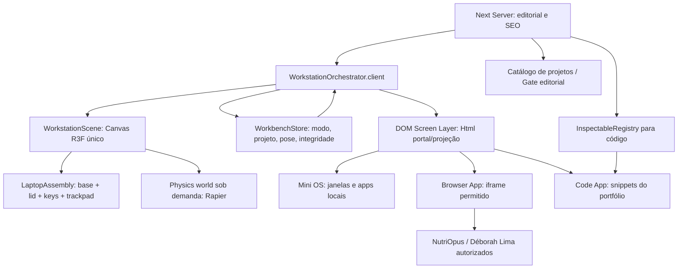
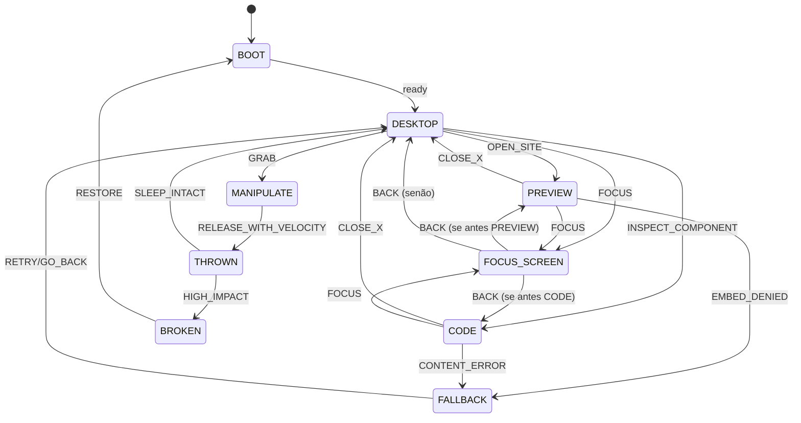

# 03 — Arquitetura proposta sobre o código atual

## 1. Baseline real (14/10/2026)
Base `feat/creative-direction-recovery` no SHA `5c607eb17d29d536620e0cd2080f8202586441b3`. O código atual **não tem notebook**. A experiência anterior implementou um companion 3D persistente ao longo das seções via portal/body com um só Canvas (`src/features/creative/companion.ts`, `CreativeRuntime.client.tsx`, `src/components/hero/HeroArtBoundary.client.tsx`, `src/graphics/hero/HeroScene.client.tsx`). Usar esse mecanismo como antecedente **para a posição dinâmica na página**, mas não inserir a máquina física dentro da `HeroScene` até decidir quem controla câmera e geometria. Evitar dois Canvas globais concorrentes.

O catálogo está em `src/features/projects/project-data.ts`/`project-types.ts`; no código auditado `demo?: VerifiedLink` e `caseStudy` são opcionais e só podem ser publicados após verificação. `WorkSection.tsx`/`ProjectCarousel.client.tsx` já fornecem seleção e contador. `src/features/content/visibility.ts` e `release-gate.ts` impedem publicar drafts. A camada de cor/tema (`theme-client.ts`, tokens.css) e `MotionRuntime.client.tsx` devem ser preservados. `src/app/[locale]/page.tsx` permanece Server Component. `next.config.ts` possui CSP `default-src 'self'` **sem `frame-src`**; por isso o parent bloqueia site de outro domínio mesmo quando o filho permitisse.

## 2. Separação de camadas


### Geometria/DOM
**Dois planos sincronizados, uma tela:** chassis/tampa/teclas como mesh 3D; tela do notebook como DOM acessível projetado via Drei `<Html transform>` OU overlay 2D calculado a partir da matriz de projeção do display. Não usar render-to-texture de um iframe externo (o navegador não expõe essa textura arbitrariamente para WebGL). Para navegação real, a tela é DOM de verdade com `iframe`; CSS3D tem limites de clipping/occlusão/distorção; medir e, se necessário, usar `FOCUS_SCREEN` (painel DOM 2D) para interação. A escolha final da tecnologia deve ser validada com um teste de mouse/teclado na primeira POC.

### Proposta de pastas (a criar, sem assumir existentes)
```text
src/
  features/workstation/
    models/  LaptopModel.tsx LaptopHinge.tsx KeyboardMesh.tsx TrackpadMesh.tsx
    scene/   WorkstationCanvas.client.tsx OrbitManipulator.tsx PhysicsStage.tsx Wall.tsx
    screen/  ScreenPortal.client.tsx FocusScreen.client.tsx ScreenFrame.client.tsx
    os/      DesktopApp.client.tsx WindowManager.client.tsx apps/{Projects,Code,Browser,About,Terminal,Playground}.tsx
    state/   workstation-machine.ts workstation-store.ts selectors.ts
    physics/ impacts.ts breakable.ts restore.ts
    code/    registry.ts manifest-types.ts load-snippet.ts
    sites/   site-registry.ts embed-policy.ts site-status.ts
    orchestrator/ WorkstationOrchestrator.client.tsx SectionAnchorTracker.client.tsx
  styles/workstation.css
scripts/generate-workstation-snippets.mjs
public/models/workstation/ (se o modelo for próprio/licenciado)
tests/unit/workstation-*.test.ts
tests/e2e/workstation-*.spec.ts
```

## 3. Máquina de estados explícita
Estados primários (união discriminada): `BOOT`, `DESKTOP`, `PREVIEW(siteId)`, `CODE(componentId)`, `FOCUS_SCREEN(previousMode)`, `MANIPULATE`, `THROWN`, `BROKEN`, `FALLBACK`. Estados secundários: `lidAngle`, `pose`, `quality`, `focusedWindow`, `selectedProject`, `damageLevel` e `sceneVisibility`.

Invariantes:
- `BROKEN` nunca mantém iframe/código em overlay clicável; descarregar ou congelar antes da colisão e restaurar após reconstrução.
- `FOCUS_SCREEN` nunca disputa drag com o Canvas: pointer da tela fica no DOM até fechar.
- `MANIPULATE` e `THROWN` desativam pointer-events do iframe para evitar perda de captura gestual.
- `PREVIEW` não pode carregar URL fora do registro de hosts explícitos.
- `CODE` só recebe `componentId` registrado; NUNCA caminho arbitrário digitado em URL.
- `FALLBACK` expõe os mesmos links reais, conteúdo do portfólio e controles de escolha, sem física.

Transições prioritárias:


## 4. Integração pontual sem destruir S00-S03.5
- `page.tsx`: instalar `WorkstationOrchestrator` e markers/IDs em regiões selecionadas; **não** tornar todos os Server Components clientes.
- `HeroEditorial.tsx`: reservar ancoragem e copy; primeiro notebook substitui/convive temporariamente com `HeroArtBoundary` via feature flag. Não carregar orb + laptop + physics simultaneamente.
- `WorkSection.tsx`: emitir `selectProject(slug)` além do slide ativo; usar eventos tipados/Store, não `document.dispatchEvent` sem contrato quando possível.
- `About/Expertise/Services/Contact`: seções editoriais continuam no SSR; anchors para coreografar pose/lado do notebook; não engolir conteúdo.
- `MotionRuntime` continua responsável por reveals genéricos; WorkstationScene cuida **somente** do laptop, sem dois rAF loop globais.
- `ThemeToggle`, `LanguageSwitch`, `release-gate`, `i18n` continuam intactos e recebem textos novos para UI do OS.
- `project-data`: acrescentar `livePreviewConfig` verificado, não inferir URL externa de `demo` nem aprovar automaticamente.

## 5. Padrões de comunicação
`useSyncExternalStore`/Zustand opcional conforme escala, estado serializável exceto refs de mesh. `Canvas` registra callbacks para rotação/lid/collision; `DOM Screen` observa view-model sem reenviar eventos a cada frame React. Geometria: refs/rapier, camera matrix; scroll: listener passivo coalescido em rAF com cleanup; telas: cliente lazy e iframe condicionado à visualização/estado. `postMessage` **apenas** quando site cooperar, com `origin` e `source` verificados e schema validado.

## 6. ADRs a escrever na implementação
ADR-W01 Layout companheiro não split; ADR-W02 DOM projetado em screen vs iframe-to-texture inviável; ADR-W03 real embed e CSP; ADR-W04 interação/foco vs física; ADR-W05 política code somente próprio repo; ADR-W06 reciclagem de canvas da recovery e regressões.
