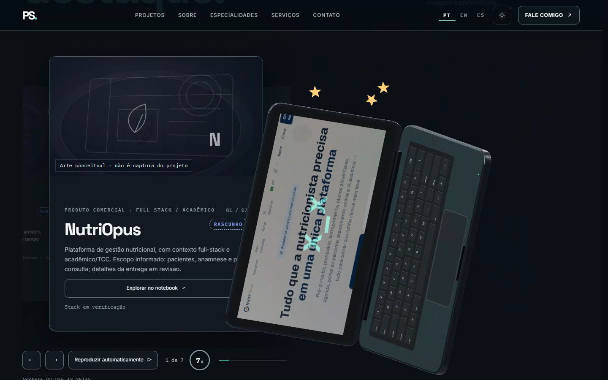
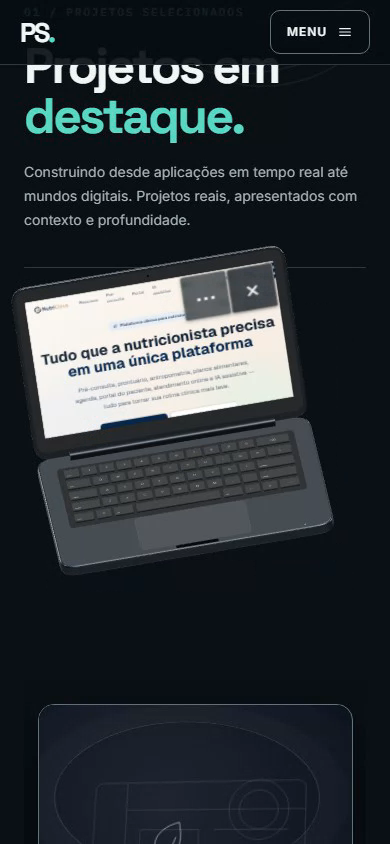

# P02.2 — evidências visuais

Websites reais, entradas nativas do navegador, um único Canvas. Vídeos originais do Playwright, sem aceleração/interpolação. SwiftShader não representa fluidez em GPU física.

## Vídeos online e física

- [1440px — sites, scroll/link nativos, ×, arremesso e impactos](videos/pt-live-1440-websites-impact.webm) · 150.44s · 1440×900 · SHA-256 `95ff5fb3dad4eda6552d7b5491f9ee7a71688bc6d02499fb74f6793decd21c62`
- [390px — sites, scroll/link nativos, ×, arremesso e impactos](videos/pt-live-390-websites-impact.webm) · 86.16s · 390×844 · SHA-256 `d4ca8f36c86b7a62d482336679602ccab3082681ca457a4fdc8006ed5a15c12e`

Cada vídeo mostra NutriOpus e Déborah pelo carrossel, sem substituição por fixture/imagem. Os manifestos guardam os URLs, epoch do documento, fases e os estados físicos.

## Sites e impactos

Desktop inclui colisão com o teto; mobile inclui colisão lateral. Ambos mostram arremesso ao chão e recuperação.

Quadros decodificados dos originais (seek e hashes em [video-frames.json](video-frames.json)):

- [pt-live-1440-nutriopus-dark.png](screenshots/pt-live-1440-nutriopus-dark.png)
- [pt-live-1440-nutriopus-scroll.png](screenshots/pt-live-1440-nutriopus-scroll.png)
- [pt-live-1440-nutriopus-light.png](screenshots/pt-live-1440-nutriopus-light.png)
- [pt-live-1440-nutriopus-exit-hover.png](screenshots/pt-live-1440-nutriopus-exit-hover.png)
- [pt-live-1440-deborah-dark.png](screenshots/pt-live-1440-deborah-dark.png)
- [pt-live-1440-deborah-scroll.png](screenshots/pt-live-1440-deborah-scroll.png)
- [pt-live-1440-deborah-light.png](screenshots/pt-live-1440-deborah-light.png)
- [pt-live-1440-deborah-exit-hover.png](screenshots/pt-live-1440-deborah-exit-hover.png)
- [pt-live-1440-first-impact.png](screenshots/pt-live-1440-first-impact.png)
- [pt-live-1440-ceiling.png](screenshots/pt-live-1440-ceiling.png)
- [pt-live-1440-final.png](screenshots/pt-live-1440-final.png)
- [pt-live-390-nutriopus-dark.png](screenshots/pt-live-390-nutriopus-dark.png)
- [pt-live-390-nutriopus-scroll.png](screenshots/pt-live-390-nutriopus-scroll.png)
- [pt-live-390-nutriopus-light.png](screenshots/pt-live-390-nutriopus-light.png)
- [pt-live-390-deborah-dark.png](screenshots/pt-live-390-deborah-dark.png)
- [pt-live-390-deborah-scroll.png](screenshots/pt-live-390-deborah-scroll.png)
- [pt-live-390-deborah-light.png](screenshots/pt-live-390-deborah-light.png)
- [pt-live-390-first-impact.png](screenshots/pt-live-390-first-impact.png)
- [pt-live-390-side.png](screenshots/pt-live-390-side.png)
- [pt-live-390-final.png](screenshots/pt-live-390-final.png)

## Matriz PT/EN/ES × Dark/Light × desktop/mobile

### pt-dark-1440

- [pt-dark-1440-hero.png](screenshots/pt-dark-1440-hero.png)
- [pt-dark-1440-terminal-focus.png](screenshots/pt-dark-1440-terminal-focus.png)
- [pt-dark-1440-code-focus.png](screenshots/pt-dark-1440-code-focus.png)
- [pt-dark-1440-about.png](screenshots/pt-dark-1440-about.png)

### pt-dark-390

- [pt-dark-390-hero-top.png](screenshots/pt-dark-390-hero-top.png)
- [pt-dark-390-hero.png](screenshots/pt-dark-390-hero.png)
- [pt-dark-390-terminal-focus.png](screenshots/pt-dark-390-terminal-focus.png)
- [pt-dark-390-code-focus.png](screenshots/pt-dark-390-code-focus.png)
- [pt-dark-390-about.png](screenshots/pt-dark-390-about.png)

### pt-light-1440

- [pt-light-1440-hero.png](screenshots/pt-light-1440-hero.png)
- [pt-light-1440-terminal-focus.png](screenshots/pt-light-1440-terminal-focus.png)
- [pt-light-1440-code-focus.png](screenshots/pt-light-1440-code-focus.png)
- [pt-light-1440-about.png](screenshots/pt-light-1440-about.png)

### pt-light-390

- [pt-light-390-hero-top.png](screenshots/pt-light-390-hero-top.png)
- [pt-light-390-hero.png](screenshots/pt-light-390-hero.png)
- [pt-light-390-terminal-focus.png](screenshots/pt-light-390-terminal-focus.png)
- [pt-light-390-code-focus.png](screenshots/pt-light-390-code-focus.png)
- [pt-light-390-about.png](screenshots/pt-light-390-about.png)

### en-dark-1440

- [en-dark-1440-hero.png](screenshots/en-dark-1440-hero.png)
- [en-dark-1440-terminal-focus.png](screenshots/en-dark-1440-terminal-focus.png)
- [en-dark-1440-code-focus.png](screenshots/en-dark-1440-code-focus.png)
- [en-dark-1440-about.png](screenshots/en-dark-1440-about.png)

### en-dark-390

- [en-dark-390-hero-top.png](screenshots/en-dark-390-hero-top.png)
- [en-dark-390-hero.png](screenshots/en-dark-390-hero.png)
- [en-dark-390-terminal-focus.png](screenshots/en-dark-390-terminal-focus.png)
- [en-dark-390-code-focus.png](screenshots/en-dark-390-code-focus.png)
- [en-dark-390-about.png](screenshots/en-dark-390-about.png)

### en-light-1440

- [en-light-1440-hero.png](screenshots/en-light-1440-hero.png)
- [en-light-1440-terminal-focus.png](screenshots/en-light-1440-terminal-focus.png)
- [en-light-1440-code-focus.png](screenshots/en-light-1440-code-focus.png)
- [en-light-1440-about.png](screenshots/en-light-1440-about.png)

### en-light-390

- [en-light-390-hero-top.png](screenshots/en-light-390-hero-top.png)
- [en-light-390-hero.png](screenshots/en-light-390-hero.png)
- [en-light-390-terminal-focus.png](screenshots/en-light-390-terminal-focus.png)
- [en-light-390-code-focus.png](screenshots/en-light-390-code-focus.png)
- [en-light-390-about.png](screenshots/en-light-390-about.png)

### es-dark-1440

- [es-dark-1440-hero.png](screenshots/es-dark-1440-hero.png)
- [es-dark-1440-terminal-focus.png](screenshots/es-dark-1440-terminal-focus.png)
- [es-dark-1440-code-focus.png](screenshots/es-dark-1440-code-focus.png)
- [es-dark-1440-about.png](screenshots/es-dark-1440-about.png)

### es-dark-390

- [es-dark-390-hero-top.png](screenshots/es-dark-390-hero-top.png)
- [es-dark-390-hero.png](screenshots/es-dark-390-hero.png)
- [es-dark-390-terminal-focus.png](screenshots/es-dark-390-terminal-focus.png)
- [es-dark-390-code-focus.png](screenshots/es-dark-390-code-focus.png)
- [es-dark-390-about.png](screenshots/es-dark-390-about.png)

### es-light-1440

- [es-light-1440-hero.png](screenshots/es-light-1440-hero.png)
- [es-light-1440-terminal-focus.png](screenshots/es-light-1440-terminal-focus.png)
- [es-light-1440-code-focus.png](screenshots/es-light-1440-code-focus.png)
- [es-light-1440-about.png](screenshots/es-light-1440-about.png)

### es-light-390

- [es-light-390-hero-top.png](screenshots/es-light-390-hero-top.png)
- [es-light-390-hero.png](screenshots/es-light-390-hero.png)
- [es-light-390-terminal-focus.png](screenshots/es-light-390-terminal-focus.png)
- [es-light-390-code-focus.png](screenshots/es-light-390-code-focus.png)
- [es-light-390-about.png](screenshots/es-light-390-about.png)

## Manifestos e medições

- [Vídeos/sites reais e fases](live-evidence.json)
- [Matriz, hashes das fontes e estados](evidence.json)
- [Métricas consolidadas](metrics.json)
- [Hidratação lenta](hydration.json)

Tentativas iniciais, traces, relatórios completos e logs de contato permanecem em `docs/report/Workstation/P02.2/`, fora do Git.
