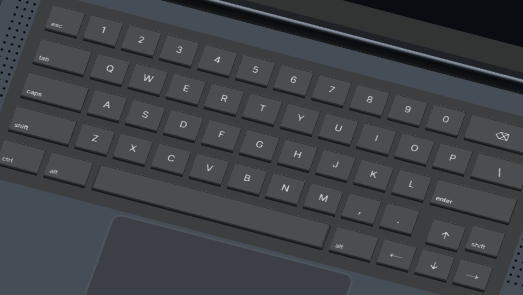

# Teclado 3D — bloco de setas em T invertido

**21/10/2026 · Codex.** Base exata `64ee99e327b5c6ff0759a1829c9bdbbcb93f5533`, árvore limpa em `feat/workstation-playful-notebook`. Pedido do proprietário: corrigir a seta para cima isolada, preservando o teclado/modelo do Claude e garantindo que os cliques acompanhem a posição visual.

## Correção

As quatro setas usam a mesma largura das teclas de uma unidade (**0,195**) e a mesma profundidade (**0,18**). `↑` e `↓` compartilham x = **1,15**; `← ↓ →` ficam alinhadas em z = **0,20**, separadas por 0,23 entre centros. `↑` fica em z = **−0,015**, deixando o mesmo vão físico de **0,035** nas duas direções. Não há interseção com outra tecla nem saída do rebaixo do teclado.

A reserva de espaço exigiu reduzir o Shift direito para uma unidade e separar a pontuação do cluster por um espaçador de 0,25 unidade, que não gera malha nem alvo invisível. A última fileira usa espaço de 6,25 unidades e reposiciona seus Alt para preencher a antiga posição da seta para cima. Letras, números, pontuação, Tab, Caps, Enter, Shift esquerdo e o corpo do notebook conservam suas posições/dimensões. A quantidade de teclas permanece **54**. Esses são os ajustes adjacentes necessários, sem reformular o restante do teclado.

## Malha, legenda e clique

`NOTEBOOK_KEYS` continua sendo a única lista de posições/ordem. A malha instanciada e as legendas leem essa lista; o raycast identifica o `instanceId` da própria tecla e consulta a mesma lista para executar o comando. Não foi criada uma hitbox separada que pudesse divergir da malha. `KEY_DEPTH` passa a ser compartilhada por geometria, escala física das legendas e espaçamento vertical.

| Arquivo | Alteração |
|---|---|
| `src/features/workstation/input/keyboard-layout.ts` | Cluster, reserva de espaço e profundidade comum |
| `src/features/workstation/models/LaptopModel.client.tsx` | Usa a profundidade comum na malha e nas legendas; valor/material inalterados |
| `src/features/workstation/models/key-legends.ts` | Usa a mesma profundidade ao desenhar o atlas |
| `tests/unit/workstation-arrow-cluster.test.ts` | Sete regressões de disposição, dimensões, espaçamento, colisões e mapeamento de comandos |
| `tests/workstation/arrow-cluster.spec.ts` | Quatro cenários desktop/mobile × Dark/Light, cliques/toques nas quatro malhas e capturas |

`hit-targets.ts`, o raycast da cena, o controlador de texto, materiais, cores, fontes, física, tampa e trajetória não foram modificados. Modelo e arquitetura herdados de Claude foram reaproveitados; somente esta correção e suas evidências são atribuídas a Codex.

## Regressão e evidências

Antes da correção, os novos unitários reproduziram **duas falhas / cinco PASS**: `↑.x = −1,0925` contra `↓.x = +1,0925`, e a seta direita tinha largura 0,2525 contra 0,195 das pequenas. Depois, os sete passaram. As quatro direções partem da mesma seleção no texto `abcd\nefgh\nijkl` e devem alcançar posições diferentes (2, 6, 12, 8), sem alterar o conteúdo.

O E2E não dispara `input.key` diretamente nem sintetiza um evento de seta: clica/toca as coordenadas projetadas das quatro teclas reais e verifica o cursor do app Notas. A abertura de “Ver teclado” usa o menu existente. Sem force click, alteração de pose por script ou substituição de hit targets.

| Validação final | Resultado |
|---|---|
| Lint, typecheck e build preview/laboratório (`npm run verify`) | PASS |
| Unitários completos | **181 PASS / 20 arquivos** |
| Nova matriz no servidor de desenvolvimento | **4/4 PASS** |
| E2E selecionados no build otimizado, uma execução | **7/7 PASS**, zero falha/skip/flaky, 2,5min |
| Setas, mouse e touch | Cada caso validou `↑ ← ↓ →` e as quatro posições distintas do cursor |
| Regressões existentes | Digitação 3D no desktop/Terminal, Shift/Caps/Backspace/Notas e trackpad PASS |
| Capturas | **8 PNGs**, desktop/mobile × Dark/Light, vista do notebook e recorte do teclado |

Fonte, hashes das capturas, coordenadas realmente clicadas e resultados: [evidence.json](evidence.json). A primeira validação de tipos encontrou anotações ausentes no novo E2E; foram corrigidas antes da execução final, sem mudar o comportamento do produto ou relaxar as asserções. Logs das tentativas permanecem no diretório ignorado.

Capturas nativas do navegador, sem retoque, em 1440×900 e 390×844:

| Tema | Desktop | Mobile touch |
|---|---|---|
| Dark | [Notebook](dark-1440-notebook.png) · [Teclado](dark-1440-keyboard.png) | [Notebook](dark-390-notebook.png) · [Teclado](dark-390-keyboard.png) |
| Light | [Notebook](light-1440-notebook.png) · [Teclado](light-1440-keyboard.png) | [Notebook](light-390-notebook.png) · [Teclado](light-390-keyboard.png) |



## Reprodução

```powershell
$env:PORTFOLIO_CONTENT_PREVIEW='1'
$env:EXPERIMENTAL_WORKSTATION='1'
npm run verify
$env:QA_MANAGE_SERVER='1'
$env:QA_WORKSTATION_TEST_REPORT='docs/report/Workstation/P02.2/arrow-cluster/production-e2e.json'
npx playwright test --config playwright.workstation.config.ts arrow-cluster.spec.ts input-motion.spec.ts -g 'visible caps|3D keys type|real 3D keys edit Notes|trackpad moves'
```

O roteiro cria as capturas nesta pasta; `QA_WORKSTATION_ARROWS_OUTPUT` permite outro destino. Resultados completos/traces/logs permanecem em `docs/report`, ignorado pelo Git. Esta correção não altera conteúdo editorial nem representa uma nova medição de performance ou nova aprovação do portfólio. Navegador: Chromium/SwiftShader; mobile validado com viewport e entrada touch emulados.
