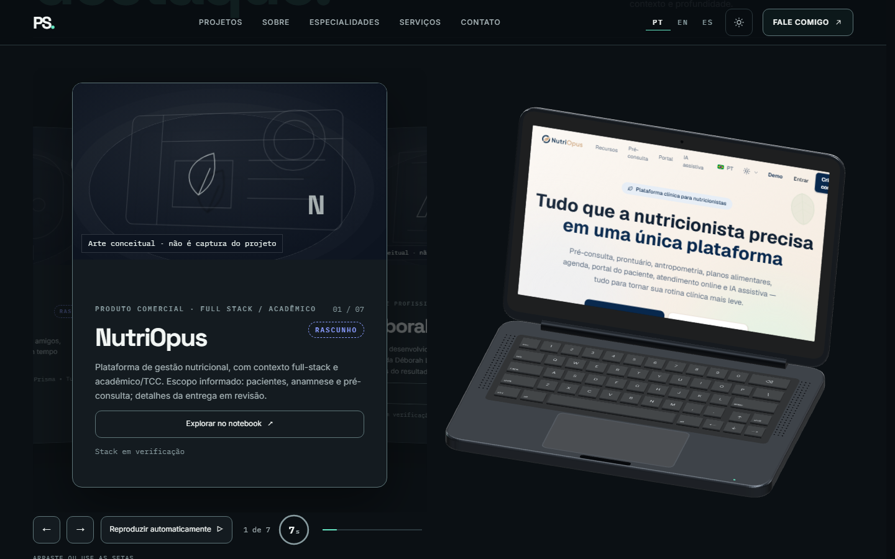
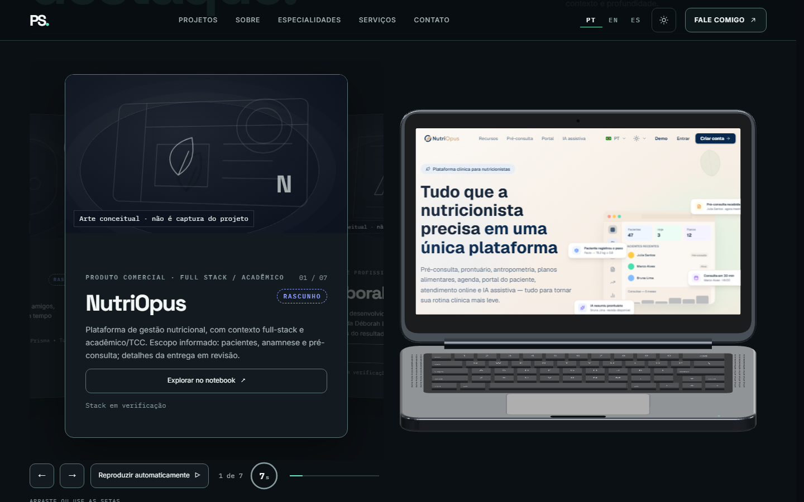
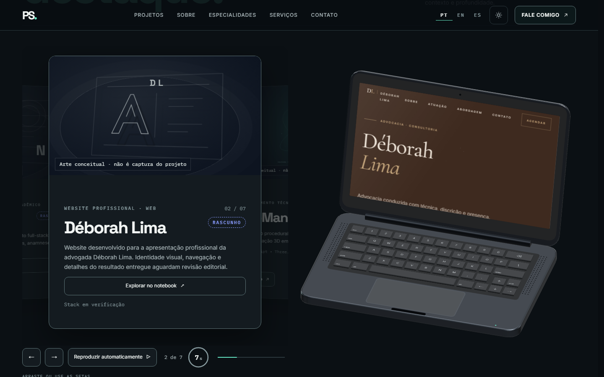
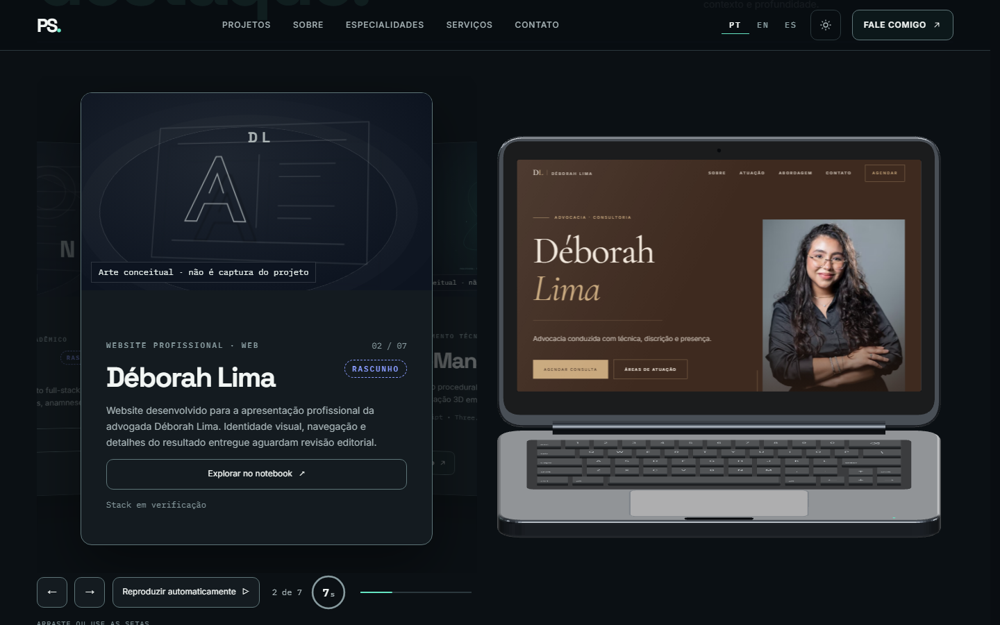
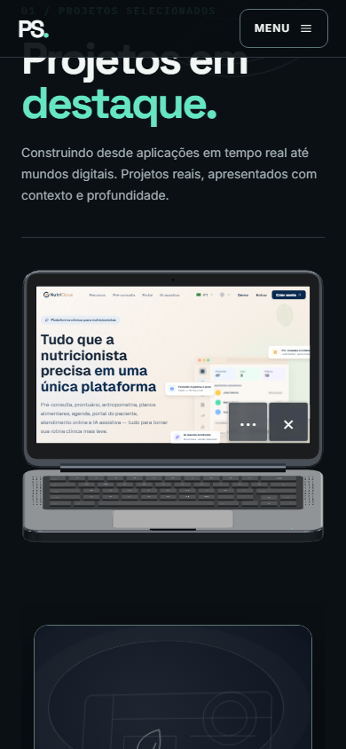
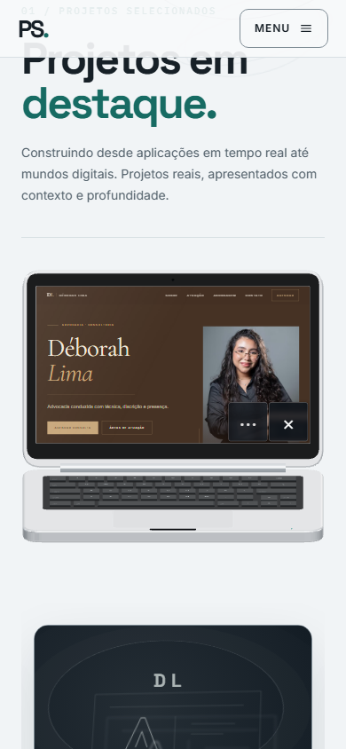
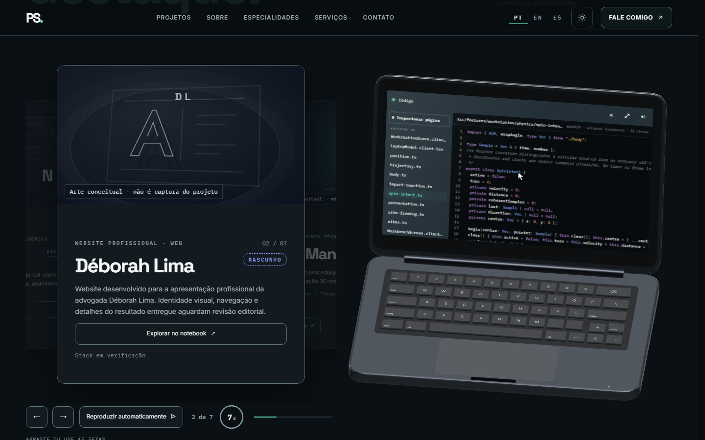
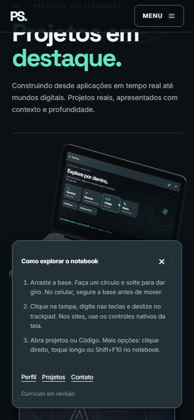

# P03 — comparação visual

[Relatório, testes e limitações](REPORT.md) · [Galeria HTML com vídeos](review.html) · [Manifesto e hashes](evidence-manifest.json).

As imagens anteriores foram capturadas na base `6dedb39`, antes da alteração. As posteriores mostram os sites remotos reais. O rótulo de arte conceitual pertence à imagem herdada do card do carrossel; o conteúdo no display é o website navegável.

| NutriOpus — antes, 800px | Depois — 1024px, pose de leitura |
|---|---|
|  |  |

| Déborah — antes, layout estreito | Depois — 1200px, título e retrato |
|---|---|
|  |  |

| Touch/Dark, NutriOpus | Touch/Light, Déborah |
|---|---|
|  |  |

Os controles touch no canto inferior mantêm alvos de 44px e deixam a navegação superior livre. Os sites são miniaturas no celular; foco 2D e abertura externa são alternativas de leitura.

Vídeos originais em tempo nativo: [mouse/desktop](videos/pt-cinematic-1440-spin-sites-code.webm), [toque/mobile](videos/pt-cinematic-390-spin-sites-code.webm). Mostram círculo, soltura, retorno, sites reais, interação nativa, mudança de tema, rotação manual, retomada da pose e Código. Duração/dimensões/hashes no manifesto. A aprovação estética e testes em hardware físico pertencem a uma revisão humana posterior.
